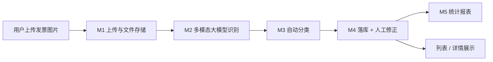

# smart-invoice-assistant · 智能发票识别与自动分类助手

> 上传一张发票图片，AI 自动提取金额、日期、公司名，并自动分类为「餐饮 / 交通 / 购物 / 办公 / 科研 / 住宿 / 会议培训」，最后落库统计。一个跑通「**上传 → 识别 → 分类 → 落库 → 人工修正 → 统计**」完整闭环的后端项目。

---

## ✨ 核心亮点（产品思维）

1. **完整闭环**：从图片上传到可视化统计，每一步都能演示、能落地，不是"只调了一次 API"。
2. **非发票判断**：先判断"这是不是发票"，非发票直接标记 `NOT_INVOICE`，而不是硬编金额骗你说成功。
3. **识别与分类解耦**：分类命中 `OTHER`（其他）**不代表识别失败**——真发票没命中 7 类时归"其他"，只有"不是发票"才提示不可信。
4. **人工修正兜底**：识别不准可在页面上手动改金额/日期/公司/分类，体现了对"AI 不确定性"的产品化处理。
5. **异常兜底**：图片糊了、识别失败、字段缺失都单字段降级，不因一个字段失败拖垮整个结果。

---

## 🔄 核心闭环



---

## 🚀 功能特性

- ✅ 图片上传（服务端校验格式/大小，本地磁盘存储）
- ✅ 多模态大模型识别（金额 / 日期 / 公司名，一次调用完成抽取 + 分类）
- ✅ 7 大分类 + 其他兜底
- ✅ 非发票判断（isInvoice）
- ✅ 发票列表 / 详情 / 人工修正 / 删除
- ✅ 统计可视化（分类占比饼图 + 月度趋势柱状图）
- ✅ 数据持久化（H2 文件数据库，重启不丢）
- ✅ 统一响应体与全局异常处理

---

## 🛠 技术选型

| 层面 | 选型 | 说明 |
|---|---|---|
| 语言 / 框架 | JDK 17 + Spring Boot 3.2.5 | 单体应用，LTS 稳定 |
| 构建 | Maven | 依赖管理 |
| Web | Spring Web (REST) + Thymeleaf | 接口 + 简单页面 |
| 持久层 | MyBatis-Plus 3.5.7 | CRUD 免 SQL |
| 数据库 | H2（文件模式） | 零安装，数据落盘到 `data/` |
| AI | 智谱 GLM-4V-Flash（多模态大模型） | 识别 + 分类一次完成 |
| HTTP 调用 | Spring `RestClient` | 内置，无额外依赖 |
| 辅助 | Lombok + Hutool 5.8.32 | 减少样板代码 |
| 文件存储 | 本地磁盘 `uploads/` | 不引入 OSS |

---

## 📁 模块划分

按功能分包（package-by-feature），每个模块自成一体：

```
smart-invoice-assistant
├── pom.xml
├── README.md
├── .gitignore
├── docs/                     # 架构 / API / 分类 / 演示脚本
└── src/main/
    ├── java/com/smartinvoice/invoice/
    │   ├── SmartInvoiceApplication.java
    │   ├── upload/            # M1 上传与文件存储
    │   │   ├── controller/FileUploadController.java
    │   │   └── service/FileStorageService.java、StoredFile.java
    │   ├── ai/                # M2+M3 识别与分类
    │   │   ├── client/ZhipuClient.java        # 调大模型
    │   │   ├── service/RecognitionService.java # 提示词+解析
    │   │   └── dto/RecognitionResult.java      # 识别结果
    │   ├── invoice/           # M4 发票业务（落库+人工修正）
    │   │   ├── controller/InvoiceController.java
    │   │   ├── service/InvoiceService.java
    │   │   ├── entity/Invoice.java
    │   │   ├── mapper/InvoiceMapper.java
    │   │   └── dto/InvoiceUpdateRequest.java
    │   ├── stats/             # M5 统计
    │   │   ├── controller/StatsController.java
    │   │   ├── service/StatsService.java
    │   │   └── dto/CategoryStat.java、MonthlyStat.java
    │   └── common/            # M6 公共基础
    │       └── exception/GlobalExceptionHandler.java
    └── resources/
        ├── application.yml
        ├── db/schema.sql      # 建表脚本
        └── templates/         # upload / list / stats 三个页面
```

| 模块 | 职责 |
|---|---|
| **M1 上传** | 接收图片、校验、存本地、返回 fileId |
| **M2+M3 识别与分类** | 读图 → base64 → 调大模型 → 解析 JSON（识别+分类一次完成） |
| **M4 发票业务** | 落库、列表/详情/删除、人工修正 |
| **M5 统计** | 按分类、按月聚合金额，供图表展示 |
| **M6 公共** | 统一响应体、全局异常处理 |

---

## 🚀 快速启动

### 前置要求
- JDK 17
- Maven（IDEA 自带即可）
- 智谱开放平台 API Key（`open.bigmodel.cn`，模型 `glm-4v-flash`，免费）

### 1. 配置 API Key（环境变量）

项目不再把 Key 写死在配置文件里，改从环境变量 `ZHIPU_API_KEY` 读取：

**IDEA 设置方式：**
1. 点击右上角运行配置下拉框 → `Edit Configurations...`
2. 选中 `SmartInvoiceApplication`
3. 在 **Environment variables**（环境变量）一栏点击编辑，新增一行：`ZHIPU_API_KEY=你的key`
4. `Apply` → `OK` → 重新运行

> 也可以命令行启动：`ZHIPU_API_KEY=你的key mvn spring-boot:run`

### 2. 运行
右键运行 `SmartInvoiceApplication`，看到 `Started SmartInvoiceApplication` 即启动成功。

### 3. 访问

| 地址 | 说明 |
|---|---|
| `http://localhost:8080/` | 上传发票 |
| `http://localhost:8080/list` | 发票列表（编辑/删除） |
| `http://localhost:8080/stats` | 统计图表 |
| `http://localhost:8080/h2-console` | H2 数据库控制台（JDBC URL：`jdbc:h2:file:./data/invoice`，用户 `sa`，密码空） |

---

## 🖼 功能截图

截图请放在 `docs/images/` 目录，建议包含：
- 上传页 + 识别结果（真发票）
- 非发票提示（"可能不是发票"）
- 发票列表页（人工修正）
- 统计图表（饼图 + 柱状图）

> 放好截图后，在下面补上图片引用即可，例如：
> ``

---

## 📚 文档索引

| 文档 | 内容 |
|---|---|
| [架构说明](docs/architecture.md) | 整体架构、模块职责、关键设计决策 |
| [API 清单](docs/api.md) | 全部接口的方法 / 路径 / 参数 / 返回 |
| [分类规则](docs/classification.md) | 7 大分类清单与边界规则 |
| [演示脚本](docs/demo-script.md) | 现场演示步骤 + 面试预演问答 |

---

## ⚠️ 安全提醒

- **API Key 已抽离到环境变量**，代码里不再出现明文密钥。请勿再把 Key 写回 `application.yml`。
