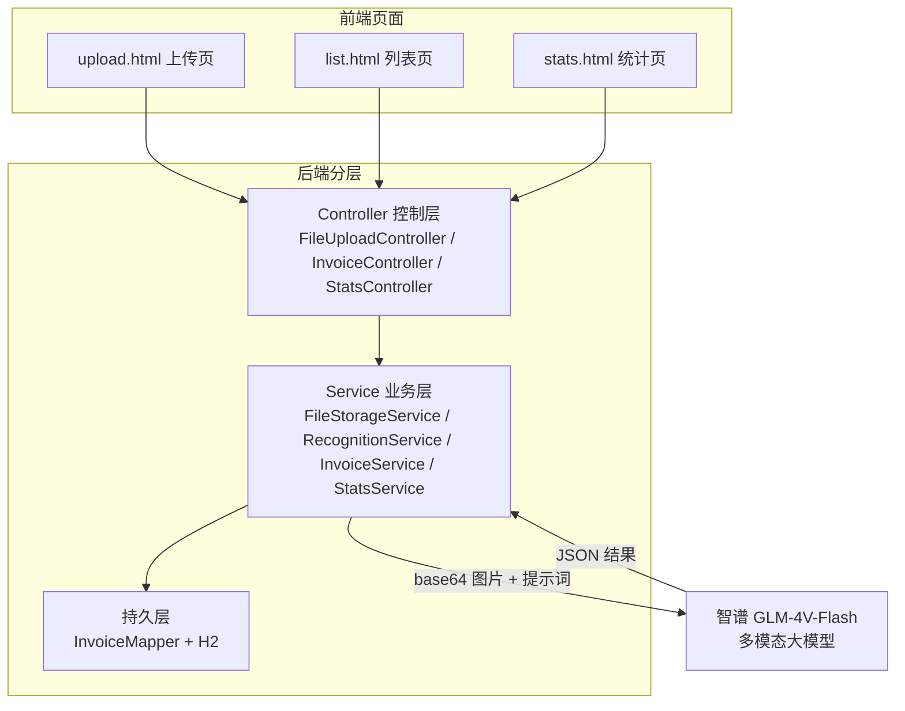
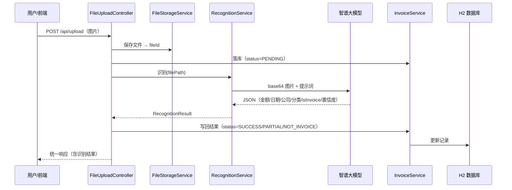

# 架构说明

## 整体架构

- **控制层（Controller）**：接收 HTTP 请求，组装统一响应 `{code, message, data}`。
- **业务层（Service）**：核心逻辑所在——文件存储、AI 识别、落库修正、统计聚合。
- **持久层（Mapper）**：MyBatis-Plus `BaseMapper`，免手写 SQL。
- **外部依赖**：智谱多模态大模型（识别 + 分类一次完成）。

---

## 数据流（闭环全链路）

---

## 模块职责

| 模块 | 职责 | 关键类 |
|---|---|---|
| M1 上传 | 接收图片、校验格式/大小、存本地磁盘、生成 fileId | `FileStorageService`、`StoredFile` |
| M2+M3 识别与分类 | 读图转 base64、构造提示词、调大模型、解析 JSON | `RecognitionService`、`ZhipuClient`、`RecognitionResult` |
| M4 发票业务 | 落库、列表/详情/删除、人工修正 | `InvoiceService`、`InvoiceController` |
| M5 统计 | 查有效发票，按分类/月份聚合金额 | `StatsService`、`StatsController` |
| M6 公共 | 统一响应体、全局异常处理 | `GlobalExceptionHandler` |

---

## 数据库设计

单表 `invoice`（文件信息内联，不拆文件表）：

| 字段 | 类型 | 说明 |
|---|---|---|
| id | BIGINT 自增 | 主键 |
| file_id | VARCHAR(64) | 关联上传文件 |
| file_path | VARCHAR(255) | 本地路径 |
| original_filename | VARCHAR(255) | 原始文件名 |
| amount | DECIMAL(10,2) | 金额 |
| invoice_date | DATE | 开票日期 |
| company | VARCHAR(255) | 公司/商户名 |
| category | VARCHAR(20) | 分类枚举 |
| confidence | DECIMAL(4,3) | 置信度 |
| status | VARCHAR(20) | PENDING/SUCCESS/PARTIAL/NOT_INVOICE/FAILED |
| need_manual_review | TINYINT | 是否需人工核对 |
| corrected | TINYINT | 是否已人工修正 |
| raw_text | VARCHAR(2000) | 模型原始文本/失败原因 |
| created_at / updated_at | TIMESTAMP | 创建/更新时间 |

---

## 关键设计决策（面试最值得讲的点）

### 1. 用多模态大模型替代传统 OCR
传统方案（Tesseract/PaddleOCR + 正则抽取）要处理图片预处理、版面分析、字段解析，工作量大、效果差。多模态大模型**一次调用同时完成 OCR + 字段抽取 + 分类**，省约 3 倍工作量，且对模糊/异形发票更稳。

### 2. 识别与分类解耦
「分类命中 OTHER」≠「识别失败」。真发票没命中 7 类时归 OTHER 是正常现象，不影响识别成功与否。只有「不是发票」才判不可信。两者用独立字段（`isInvoice` 与 `category`）表达。

### 3. 非发票独立判断
提示词先让模型回答 `isInvoice`（是不是发票）。非发票时金额/日期/公司直接置空、状态 `NOT_INVOICE`，**不硬编数据**——避免"面对一张风景照还编出金额"的假成功。

### 4. 人工修正兜底
AI 识别不是 100% 准确，因此保留「人工修正」环节：用户可手动改金额/日期/公司/分类，改完标记 `corrected=true`。这是把"AI 不确定性"产品化的关键，而非让错误结果直接进统计。

### 5. 单字段降级
金额/日期/公司任一字段缺失时，状态降为 `PARTIAL`（需人工核对），而非整体报错。能拿到多少给多少，用 `status` 标记可信度，把"是否核对"的决策交给前端/用户。

### 6. 同步调用，不引入队列/Redis
简历项目无高并发场景，识别采用同步调用即可。**不拆微服务、不加消息队列、不加对象存储、不训模型**——用最轻技术栈跑通闭环，把省下的时间投到产品闭环和文档上。

---

## 技术取舍（明确"砍掉什么"）

| 不做 | 原因 |
|---|---|
| 微服务拆分 | 单体足够，微服务徒增部署和讲解成本 |
| Redis / MQ / OSS | 无高并发场景，纯炫技且拖慢进度 |
| 自训练分类模型 | 分类交给大模型一次完成 |
| 用户鉴权 | MVP 用固定 userId 占位，避免拖慢主线 |
